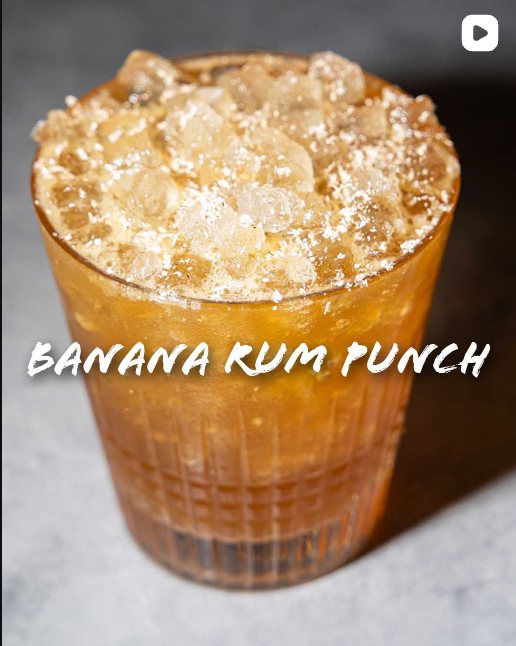

Spooky season warm-weather Jamaican banana and black tea rum punch (@theeducatedbarfly).

## Original
- 1 oz (30ml) Smith And Cross
- 1 oz (30ml) Denizen Merchants Reserve
- 1 oz (30ml) Lemon Juice
- 1/2 oz (15ml) Banana Liqueur
- 1/2 oz (15ml) Black Tea Simple
- Grated Nutmeg

1. Black Tea Simple: Add 2 tea bags to 150ml water and allow to steep for 2 minutes. Then add 150g sugar and stir til dissolved. Lasts approximately 3 weeks.
2. Whip shake all liquid ingredients with pebble ice, dump into a DOF glass over pebble ice, and garnish with grated nutmeg.

## Our version
- [x] 1 oz Jamaican rum (Smith & Cross is great)
- [ ] 1 oz aged dark rum (Demerara preferable)
- [x] 1 oz fresh lemon juice
- [ ] 0.5 oz banana liqueur (Giffard Banane du Brésil works great)
- [x] 0.5 oz black tea simple syrup (2 black tea bags steeped 2 min in 150ml water + 150g sugar)
- [x] freshly grated nutmeg

1. Make the black tea simple syrup (2 black tea bags steeped 2 min in 150ml water + 150g sugar) and chill.
2. Whip shake both rums (1 oz each), lemon juice (1 oz), banana liqueur (0.5 oz) and black tea syrup (0.5 oz) with 3-4 pebble ice cubes, dump into a DOF glass packed with pebble/crushed ice, and grate fresh nutmeg over top.

## Notes
- 2026-11-13 (via muse): relaxed Our version to style-first specs (Jamaican rum / dark rum / banana liqueur) with the favorite bottles as suggestions, so the drink can be made anywhere.
- 2026-10-19 (crews via site, 5/5): awesome drink, bit tangy w the lime. could use stronger syrup imo
- 2026-10-14 (filed by grok-bot): filed from inbox/2026-10-14-banana-rum-punch.md. Swapped food tags [quick-20, no-cook] for spirit/style tags from _system/TAGS.md and added spirit + glass; Original and Our version kept as sent.
- 2026-10-14 (via gemini): captured, sent by crews.
