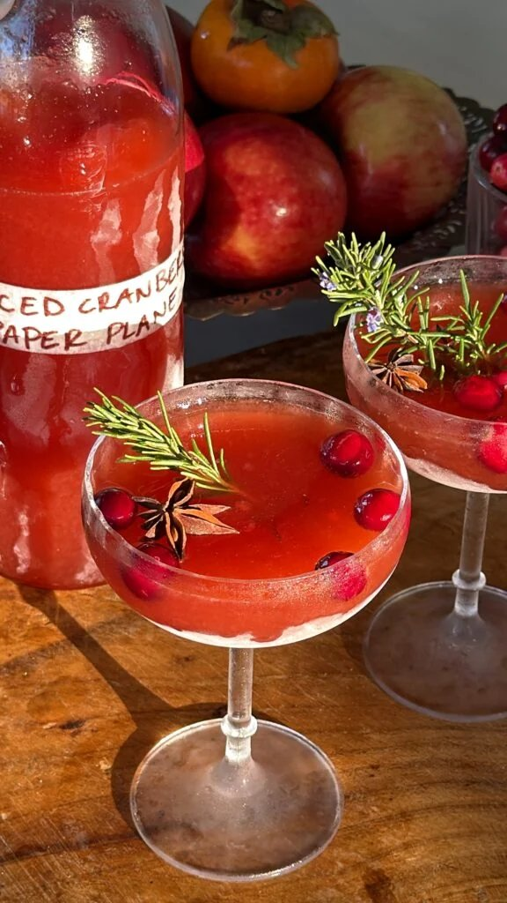

A riff on the Paper Plane, the modern classic created by Sam Ross around 2008: equal parts bourbon, Amaro Nonino, Aperol and lemon, with a festive touch of spiced cranberry syrup and batched for the freezer door, from Julianna McIntosh (@join_jules).

## Original

Freezer-door batch (about 10 pours):

- 1 cup bourbon
- 1 cup Amaro Nonino
- 1 cup fresh lemon juice
- 3/4 cup Aperol
- 1/2 cup spiced cranberry syrup (below)
- 1/4 cup filtered water, for dilution
- Orange twists or fresh cranberries, for garnish (optional)

1. Using a funnel, add the bourbon, Amaro Nonino, lemon juice, Aperol, spiced cranberry syrup and filtered water to a freezer-safe bottle.
2. Seal tightly and gently shake or invert several times to combine.
3. Freeze at least 4–6 hours, until thoroughly chilled. (It may go slightly slushy — if so, pull it out 30 minutes before serving and shake.)
4. Pour 3–4 oz into a chilled coupe or Nick & Nora glass.
5. Garnish with an orange twist or fresh cranberries. Best within 1–2 days, while the lemon juice is fresh.

Spiced cranberry syrup:

- 1 cup fresh or frozen cranberries
- 1 cup unsweetened cranberry juice
- 1 cup granulated white sugar
- Peels from 1 orange
- Juice from 1/2 orange
- 2 cinnamon sticks
- 3–4 whole cloves
- 1 star anise
- 1/4 tsp ground nutmeg
- 1 tbsp Grand Marnier (optional)

1. Combine everything in a medium saucepan over low heat, stirring until the sugar dissolves.
2. Simmer gently 15–20 minutes, until the cranberries burst and the syrup is fragrant.
3. Off the heat, steep 10–15 minutes.
4. Strain through a fine-mesh strainer, pressing the cranberries to release their juice.
5. Cool completely. Keeps in the fridge up to 2 weeks.

## Our version

### Spiced cranberry syrup

- [ ] 1 cup fresh or frozen cranberries
- [ ] 1 cup unsweetened cranberry juice
- [ ] 1 cup granulated white sugar
- [ ] Peels from 1 orange
- [ ] Juice from 1/2 orange
- [ ] 2 cinnamon sticks
- [ ] 3–4 whole cloves
- [ ] 1 star anise
- [ ] 1/4 tsp ground nutmeg
- [ ] 1 tbsp Grand Marnier (optional)

1. Combine everything in a medium saucepan over low heat, stirring until the sugar dissolves: fresh or frozen cranberries (1 cup), unsweetened cranberry juice (1 cup), granulated white sugar (1 cup), peels from 1 orange, juice from 1/2 orange, cinnamon sticks (2), whole cloves (3–4), star anise (1), ground nutmeg (1/4 tsp), and Grand Marnier (1 tbsp, optional).
2. Simmer gently 15–20 minutes, until the cranberries burst and the syrup is fragrant.
3. Off the heat, steep 10–15 minutes.
4. Strain through a fine-mesh strainer, pressing the cranberries to release their juice.
5. Cool completely. Keeps in the fridge up to 2 weeks.

### Cocktail (freezer-door batch, about 10 pours)

- [ ] 1 cup bourbon
- [ ] 1 cup Amaro Nonino
- [ ] 1 cup fresh lemon juice
- [ ] 3/4 cup Aperol
- [ ] 1/2 cup spiced cranberry syrup
- [ ] 1/4 cup filtered water, for dilution
- [ ] Orange twists or fresh cranberries, for garnish (optional)

1. Using a funnel, add the bourbon (1 cup), Amaro Nonino (1 cup), fresh lemon juice (1 cup), Aperol (3/4 cup), spiced cranberry syrup (1/2 cup) and filtered water (1/4 cup) to a freezer-safe bottle.
2. Seal tightly and gently shake or invert several times to combine.
3. Freeze at least 4–6 hours, until thoroughly chilled. (It may go slightly slushy. If so, pull it out 30 minutes before serving and shake.)
4. Pour 3–4 oz into a chilled coupe or Nick & Nora glass.
5. Garnish with an orange twist or fresh cranberries (optional). Best within 1–2 days, while the lemon juice is fresh.

## Notes
- 2026-11-26 (grok-bot): Our version now lists the syrup and the freezer-door batch as separate groups. time_minutes is 45 for making the syrup and mixing the batch; the 4-6 hour freezer chill is extra. Title dropped "Freezer Door"; slug unchanged.
- 2026-11-19 (crews via site, 4/5): cooked it.

2026-11-18 · Identified from a screenshot of @join_jules's holiday carousel ("Recipes your family actually wants to drink"); full recipe text from her site, joinjules.com. Time is an estimate and includes the 4–6 hour freezer chill.
