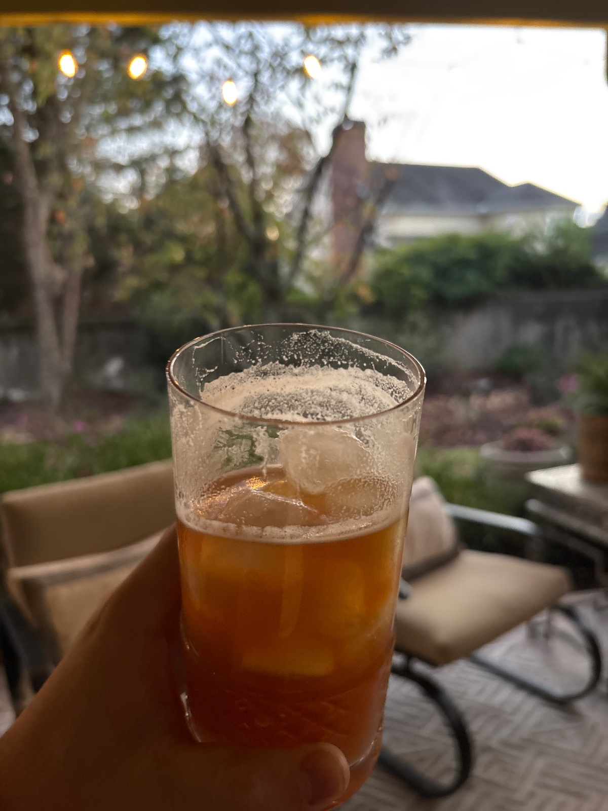

Anders Erickson's fall bourbon cocktail topped with IPA. Bourbon, apple cider and maple get shaken, then the beer goes on top.

## Original
- 1 oz bourbon (he used Still Austin)
- 1 oz apple cider
- 1/2 oz maple syrup
- 1/4 oz fresh lemon juice
- 2 dashes aromatic bitters (Angostura)
- 4 oz IPA (he used a local Legion Brewing IPA)
- Freshly grated cinnamon, to garnish

1. Shake everything except the beer with ice.
2. Strain over fresh ice in a glass.
3. Top with the IPA.
4. Garnish with freshly grated cinnamon.

## Our version
**Grocery & inventory check**
- [ ] bourbon (1 oz)
- [ ] apple cider (1 oz)
- [ ] maple syrup (1/2 oz)
- [ ] lemon (1/4 oz juice)
- [ ] Angostura bitters (2 dashes)
- [ ] IPA (4 oz)
- [ ] cinnamon stick, for grating

**Steps**
1. Shake 1 oz bourbon, 1 oz apple cider, 1/2 oz maple syrup, 1/4 oz fresh lemon juice and 2 dashes Angostura with ice.
2. Strain over fresh ice in a rocks or highball glass.
3. Top with 4 oz IPA.
4. Grate a little cinnamon over the top.

## Notes
- 2026-11-12 (crews via site, 4/5): great idea, execution could be better. prefer campari + olives
- 2026-11-11 (via muse): from an Instagram reel by @_happyhourharry_. The full spec was in the caption, so nothing was guessed. He frames it as a football-season afternoon drink.
