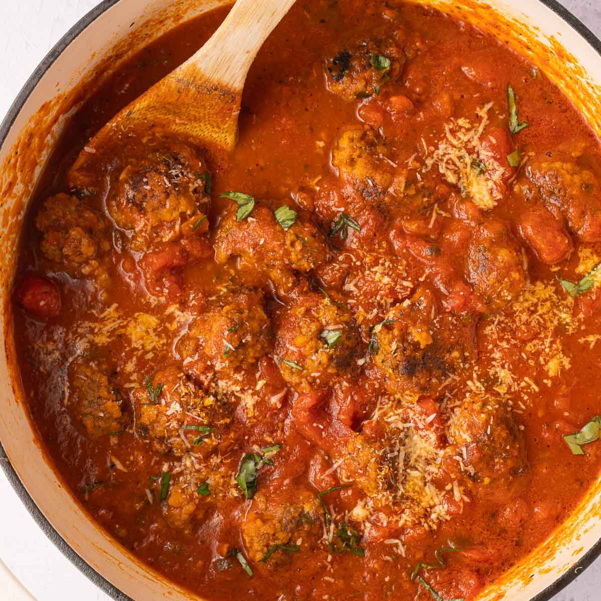

Turmeric-ginger and tomato broth with seared lamb/beef-organ meatballs, braised collards and egg white noodles, finished with herbs and a cold dollop of cottage cheese.

## Original

**Ingredients**
- [x] sourdough (for the panade)
- [ ] collard greens (1 large bunch, stems removed, chopped)
- [ ] Thai basil
- [ ] green onions
- [x] egg white spaghetti noodles
- [x] anchovy paste
- [x] tomato paste
- [x] ground beef/organ blend (1 lb)
- [x] ground lamb (1 lb)
- [x] fresh limes
- [x] full-fat cottage cheese
- [x] Fire Kettle turmeric-ginger bone broth

**Steps**
1. **Panade & mix:** soak crustless sourdough in a splash of milk or broth, mash to paste. Combine with lamb, beef/organ blend, minced garlic, white parts of green onion, salt and pepper. Golf-ball meatballs.
2. **Hard sear:** Dutch oven, medium-high. Deep crust on all sides; remove. Keep the fat.
3. **Umami base (pinçage):** tomato paste + anchovy paste into the fat, 2-3 min, stirring, until rust-colored.
4. **Deglaze & braise:** bone broth, scrape the fond. Add collards, return meatballs and juices.
5. **Simmer:** gentle bubble, covered, 15-20 min.
6. **Noodles:** boil egg white spaghetti separately; into wide shallow bowls.
7. **Assemble:** heat off, juice of one lime into the broth. Ladle over noodles, cold cottage cheese in the center, green onion tops and Thai basil.

## Our version
Same as original. Edit here after feedback.

## Notes
- 2026-10-18 (crews via site, 2.5/5): lose the bone broth and stay more italian
- 2026-10-16 (grok-bot): cooking again tonight. Still to buy: collard greens, Thai basil, green onions.
- 2026-10-14 (grok-bot): time_minutes is an estimate; the Apple Notes brief gave no time.
- 2026-10-13 (import): from Crews's Apple Notes; he liked it. Rating not recorded yet.
