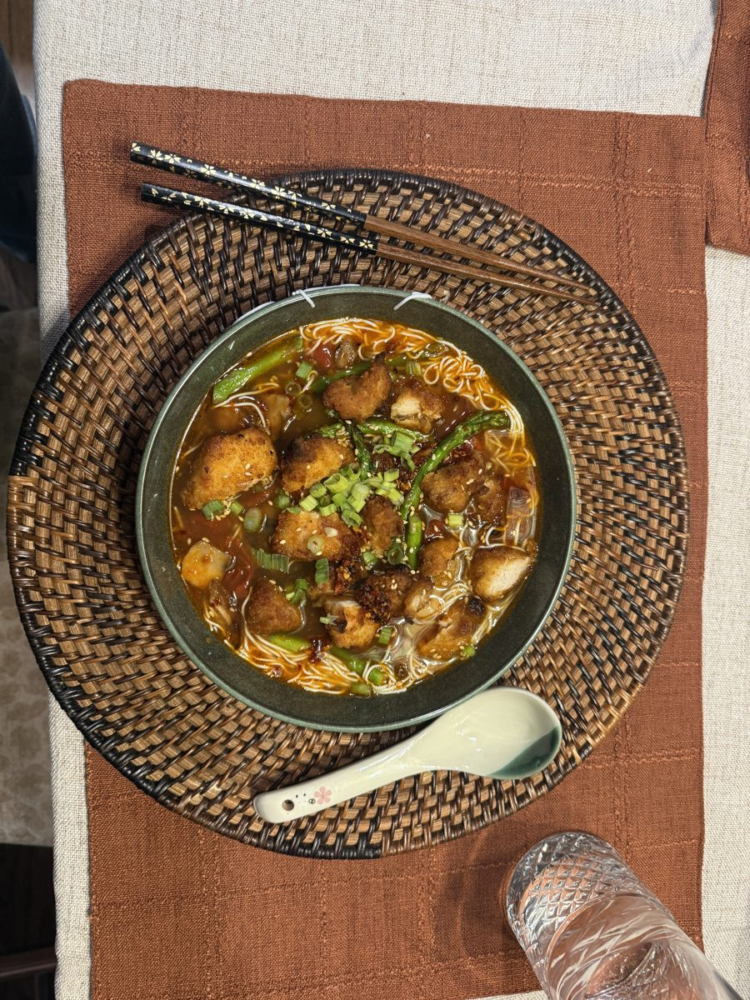

Brothy, spicy noodle bowl with a blistered tomato base, turmeric-ginger bone broth, crispy chicken and chili crisp.

## Original

**Grocery & inventory check**
- green onion (whites and greens separated, thinly sliced)
- frozen chicken nuggets
- cherry tomatoes (1 pint)
- asparagus (1 bunch, woody ends snapped, cut on a 1.5-inch bias)
- egg white spaghetti noodles
- Kettle & Fire turmeric-ginger bone broth
- chili crisp (divided)
- fresh limes
- sesame seeds

**Steps**
1. **Crisp the chicken:** air fryer at 400°F for 12-15 min until deeply crunchy (katsu texture). Rest 2 min before slicing on a bias so the crust stays intact.
2. **Char the asparagus:** splash of oil in the Dutch oven over medium-high. Sear bias-cut asparagus with a pinch of salt for 2-3 min until bright green and blistered in spots; remove to a plate so it keeps a crisp bite.
3. **Blister & smash:** add a splash of oil to the hot Dutch oven if dry. Whole cherry tomatoes, untouched 4-5 min until deeply charred underneath; toss, cook 1-2 min until bursting, then smash into a jammy base. Stir in green onion whites and 1 tsp chili crisp for 30 sec until fragrant.
4. **Build the broth:** pour in bone broth, scrape up the charred tomato fond. Steady simmer 3-4 min to marry flavors; season to taste with salt (or a splash of soy/fish sauce).
5. **Warm the noodles:** rinse egg white noodles well, then dip in boiling water 60-90 sec just to warm through (do not overboil). Drain and divide into bowls.
6. **Assemble:** blistered asparagus over noodles, ladle piping-hot broth on top. Fan sliced chicken over the top; finish with a heavy spoon of chili crisp, green onion greens, sesame seeds, and a squeeze of lime.

## Our version
Same as the original, except season the broth with liquid aminos instead of soy sauce (taste profile).

**Try next time (Buford Highway upgrades, untested):**
- Swap the egg white noodles for fresh rice noodles or fresh ramen.
- Add bok choy with the asparagus, and finish with Thai basil, bean sprouts and fried shallots.
- Stir a spoon of sambal oelek and a splash of fish sauce into the broth for more depth.

## Notes
- 2026-10-14 (crews): replaced with Crews's revised version (charred asparagus step, warmed-not-boiled noodles, timings added).
- 2026-10-14 (grok-bot): time_minutes is an estimate; the Apple Notes brief gave no time.
- 2026-10-13 (import): from Crews's Apple Notes; he liked it. Rating not recorded yet.
- 2026-10-14 (crews): made it, 3/5. Does the job but uninspired: Asian-inspired soup with basic ingredients. Egg white vermicelli noodles were weird. Buford Highway subs could make it cool.
