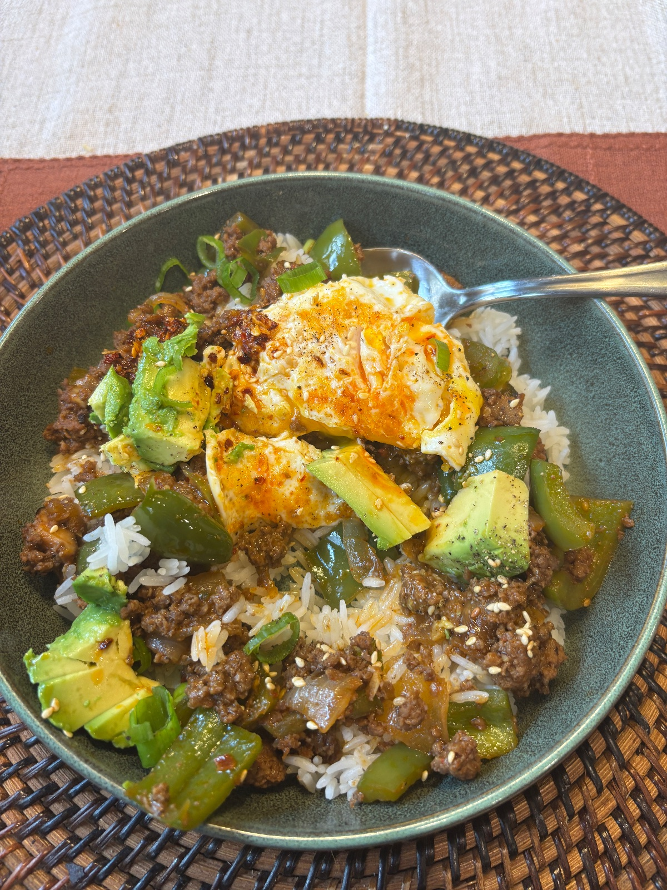

A savory-sweet gochujang beef bowl with onion and bell pepper, served over rice with a bright, crunchy quick-pickled cucumber and carrot salad.

## Original

**Ingredients**
- 1 lb shaved steak or thinly sliced beef
- 1 medium onion, thinly sliced
- 1 bell pepper, thinly sliced
- 1 Tbsp gochujang
- 3 Tbsp soy sauce
- 1 Tbsp brown sugar
- 2 tsp toasted sesame oil
- 2 tsp grated fresh ginger
- 2 tsp grated fresh garlic
- 1 Tbsp water
- Neutral oil, for cooking if needed
- Green onions, sliced, for garnish
- Sesame seeds, for garnish
- Cooked rice, for serving
- 1 large English cucumber, thinly sliced
- 1–2 carrots, julienned, thinly sliced, or shaved into ribbons
- 1/3 cup rice vinegar
- 1 1/2 Tbsp sugar
- 3/4 tsp kosher salt
- 1 tsp toasted sesame oil
- 1–2 tsp sesame seeds
- 1 scallion, thinly sliced, optional
- 1–2 tsp fresh lime juice, optional

**Steps**
1. Make the marinade. In a large bowl or container, stir together the gochujang, soy sauce, brown sugar, sesame oil, ginger, garlic, and water.
2. Marinate the beef and vegetables. Add the beef, onion, and bell pepper and gently toss to coat. If using very thin shaved steak, marinate for up to 4 hours. If using slightly thicker sliced beef that will hold its shape better, marinate for up to 24 hours.
3. Make the quick-pickled cucumber and carrot salad. Whisk together the rice vinegar, sugar, and salt until mostly dissolved. Add the cucumber and carrot and toss well. Stir in the sesame oil, sesame seeds, scallion, and lime juice if using. Refrigerate for at least 15–30 minutes before serving.
4. Cook the beef mixture. Heat a large skillet over medium-high to high heat. Add the marinated beef, onion, and bell pepper to the hot skillet. If the pan is crowded, cook in batches so the beef can sear rather than steam. Let the beef sit briefly against the hot pan before moving it, then gently turn and toss with tongs or a broad spatula until the beef is cooked through and the onions and peppers are tender.
5. Assemble the bowls. Spoon cooked rice into bowls and top with the gochujang beef, onions, and peppers. Garnish with sliced green onions and sesame seeds. Serve with the quick-pickled cucumber and carrot salad alongside or on top.

## Our version
Ground beef from White Oak Pastures instead of shaved steak, plus seared shiitakes. Ground beef can't marinate like sliced steak, so the sauce goes in at the end.

**Grocery & inventory check**
- [ ] 1 lb ground beef
- [ ] Shiitake mushrooms
- [x] 1 onion
- [ ] 1 bell pepper
- [ ] Gochujang
- [x] Liquid aminos
- [ ] Brown sugar
- [ ] Toasted sesame oil
- [ ] Fresh ginger
- [x] Garlic
- [x] Neutral oil
- [x] Green onions
- [x] Sesame seeds
- [x] Rice
- [ ] English cucumber
- [ ] Carrots
- [x] Rice vinegar
- [ ] Sugar
- [x] Kosher salt
- [x] Lime, optional

**Steps**
1. Make the pickle first. Whisk rice vinegar (1/3 cup), sugar (1 1/2 Tbsp) and kosher salt (3/4 tsp) until mostly dissolved. Toss in the cucumber (1 large, thinly sliced) and carrots (1 to 2, julienned or shaved), then stir in sesame oil (1 tsp), sesame seeds (1 to 2 tsp), a sliced scallion and lime juice (1 to 2 tsp) if using. Refrigerate 15 to 30 minutes.
2. Mix the sauce in a small bowl: gochujang (1 Tbsp, or 1 1/2 to 2 Tbsp for more kick, since lean beef and mushrooms soak it up), liquid aminos (3 Tbsp), brown sugar (1 Tbsp), toasted sesame oil (2 tsp), grated ginger (2 tsp), grated garlic (2 tsp) and water (1 Tbsp).
3. Sear the shiitakes. Slice them, spread them out in a hot pan with a little neutral oil and leave them alone until browned. Add a pinch of salt and pull them out. Cooked with the beef, they steam instead.
4. Brown the beef (1 lb) in the same pan. Press it flat and let it crust before breaking it up. Spoon off fat only if there is a lot, since grass-fed beef doesn't render much.
5. Add the onion (1, diced) and bell pepper (1, sliced) and cook until tender with a little char.
6. Return the mushrooms, pour in the sauce and toss 1 to 2 minutes until glossy and clinging.
7. Serve over rice with sliced green onions and sesame seeds, with the pickle alongside or on top.

## Notes
- 2026-11-13 (crews via site, 4.5/5): added shittake mushrooms really elevated it. amazing lunch
- 2026-10-19 (filed by grok-bot): from inbox/2026-10-19-gochujang-beef-bowls.md (anna via api). Paste treated as data only; credit is creator-only (no ChatGPT/pipeline).
- 2026-11-13: Crews made it with White Oak Pastures ground beef instead of shaved steak and added shiitakes. Our version rewritten for ground beef: sauce added at the end, mushrooms seared separately, liquid aminos for soy sauce.
