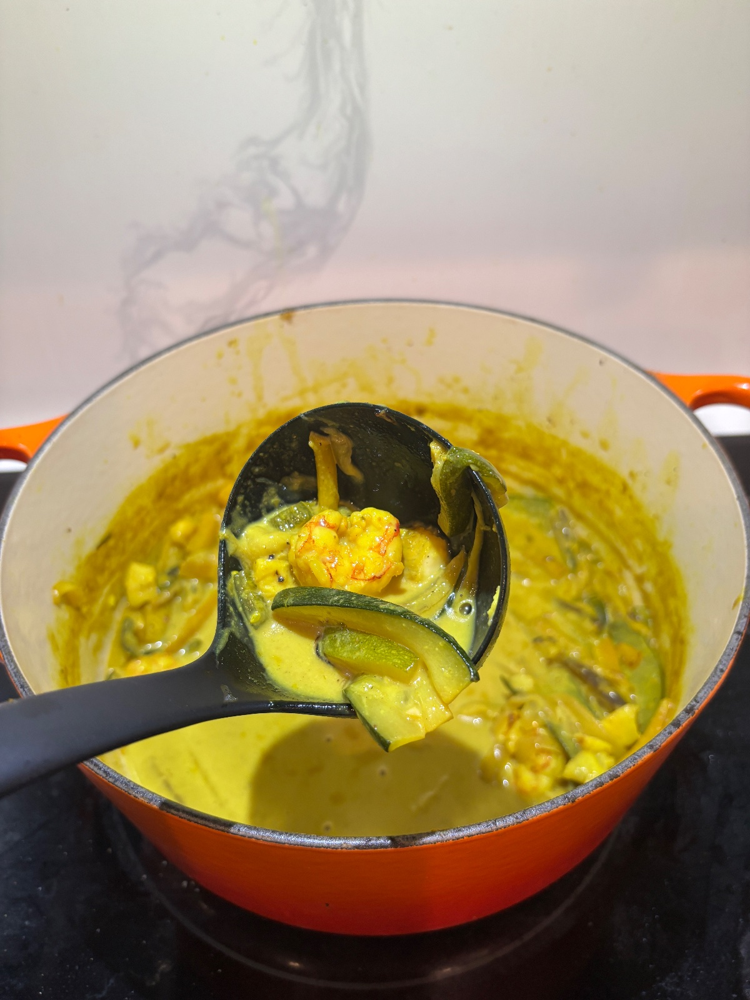

Brothy, aromatic Dutch oven seafood curry layering bloomed yellow curry, turmeric, and Szechuan-style white pepper heat with poached barramundi and shrimp.

## Original
- 1 lb Barramundi (or firm white fish), cut into large chunks
- 0.5 lb Raw Peeled Shrimp
- 1 tbsp Fresh Ginger, minced
- 4 cloves Garlic, minced
- 1-2 Serrano Peppers, thinly sliced
- 1.5 tbsp Yellow Curry Powder
- 1 tsp Ground Turmeric
- 0.5 tsp Ground White Pepper
- 2 cups Bone Broth
- 1 can (13.5 oz) Full-Fat Coconut Milk
- 1 can Bamboo Shoots, drained
- Fresh Lime Juice and Cilantro/Thai Basil (to finish)

1. In a heavy Dutch oven over medium-high heat, sauté ginger, garlic, and sliced serranos in oil until fragrant (about 1-2 minutes).
2. Add yellow curry powder, turmeric, and white pepper; bloom in the fat for 30-45 seconds until toasted.
3. Deglaze with bone broth and stir in full-fat coconut milk and bamboo shoots. Bring to a gentle simmer for 8-10 minutes to marry the broth.
4. Season fish and shrimp with salt, slide into the simmering golden broth, and gently poach for 4-6 minutes until the fish flakes and shrimp are just opaque.
5. Kill the heat and finish with fresh lime juice and herbs.

## Our version
Serves 2, about 40 minutes. If serving with rice, start it first.

**Grocery & inventory check**
- [ ] 1 lb barramundi or flounder, in 1½ to 2 inch chunks
- [ ] ½ lb raw peeled shrimp
- [ ] 1 medium yellow onion, diced or thinly sliced
- [ ] 1 tbsp fresh ginger, minced
- [x] 4 cloves garlic, minced
- [ ] 1 to 2 serrano peppers, sliced (seeded for milder)
- [ ] 1½ tbsp yellow curry powder
- [ ] 1 tsp turmeric
- [ ] ½ tsp white pepper
- [x] 2 cups bone broth
- [ ] 1 can (13.5 oz) full-fat coconut milk (not reduced fat or light)
- [ ] 1 can bamboo shoots, drained
- [x] 1 lime
- [ ] 1½ tbsp neutral oil
- [ ] Salt
- [ ] Cilantro, to finish
- [ ] Optional: a few handfuls of carrot and zucchini ribbons

**Steps**
1. Prep (10 min): dice the onion. Pat the fish and shrimp very dry and salt them lightly. Mince the ginger and garlic, slice the serranos, and mix the curry powder, turmeric and white pepper in a small bowl.
2. Heat the oil in the Dutch oven over medium until it shimmers, about 1 minute.
3. Add the onion with a pinch of salt and cook 4 to 5 minutes, stirring now and then, until soft and translucent.
4. Add the ginger, garlic and serrano and stir 60 to 90 seconds, until fragrant but not browned.
5. Drop to medium-low, add the spice mix and stir constantly 30 to 45 seconds. Add a splash of broth if it sticks.
6. Pour in the broth and scrape the bottom. Stir in the coconut milk and bamboo shoots, bring to a simmer (3 to 4 min), then simmer gently 8 to 10 minutes. Salt to taste, usually ½ to 1 tsp.
7. Lower the heat to a bare simmer. If using, stir in the carrot ribbons. Nestle in the fish, cover and cook 3 minutes.
8. Add the shrimp, and lay any zucchini ribbons on top. Cover and cook 2 to 3 minutes more, until the shrimp are pink and the fish flakes. Stir gently.
9. Off the heat, squeeze in half the lime, taste and add more lime or salt if needed (extra vegetables thin the broth). Top with cilantro and serve.

## Notes
- 2026-10-27 (crews via site, 4/5): cooked it.
- 2026-10-27 (crews): cooked it tonight, ended up ok. Had to add sugar and vinegar to balance it, and the sauce didn't have enough time for the flavors to meld. Air-fried the carrot and zucchini ribbons before adding them; roasting would be better. Next time: brown the onion longer, fry the spices in the coconut cream, add fish sauce plus a little sugar and lime, simmer the sauce 20 to 30 minutes (or make it ahead) before the seafood, and roast the veg and fold it in at the end.
- 2026-10-27 (crews): used reduced-fat coconut cream this time, which was a big problem (thin sauce, flat flavor). Use full-fat only.
- 2026-10-27 (grok-bot): added optional carrot ribbons (in with the fish) and zucchini ribbons (in with the shrimp), per crews.
- 2026-10-27 (grok-bot): added a yellow onion, sweated before the aromatics, per crews.
- 2026-10-27 (grok-bot): rewrote Our version with prep, times and step order per crews; added oil, salt and cilantro, which the original used but didn't list.
- 2026-10-14 (filed by grok-bot): filed from email 486995. Added chinese cuisine tag (Szechuan). Checklist marks match kitchen/staples.md (only garlic, bone broth, lime currently stapled). No standing soy/chili-paste subs in this recipe.
- 2026-10-14 (via gemini): captured, sent by crews. status favorite, cooks: 1 as sent (last_made and rating blank).
- 2026-10-14 (crews): made a few times last winter; 4 stars. (cooks: 3 is an estimate of "a few".)
