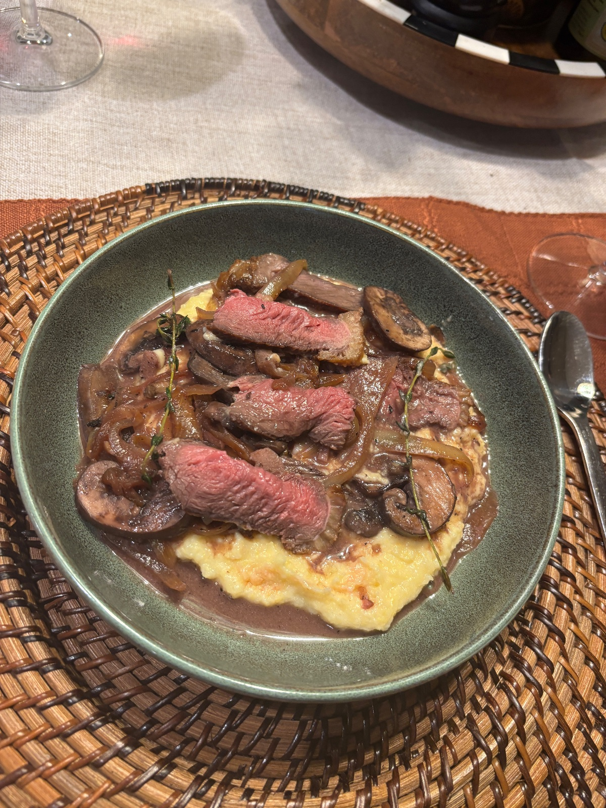

Sliced seared picanha over creamy parmesan polenta, piled with slow caramelized onions and red wine mushrooms.

## Original
Our own recipe. Crews's second fall picanha dinner: polenta, onions, mushrooms and red wine. See Our version.

## Our version
Serves 2, about 60 minutes, or about 45 if the onions are made a day ahead. Salt the steaks ahead.

**Grocery & inventory check**
- [ ] 2 picanha steaks
- [x] Kosher salt, about ¾ tsp per steak
- [x] Black pepper
- [x] 2 large yellow onions, thinly sliced
- [x] 2 tbsp butter, for the onions
- [x] 1 tbsp olive oil
- [ ] 8 oz cremini mushrooms, sliced
- [x] 2 cloves garlic, minced
- [ ] 4 sprigs fresh thyme
- [ ] ½ cup dry red wine
- [ ] 1 tsp Dijon mustard
- [ ] 1 cup polenta (coarse cornmeal, not instant or the tube)
- [ ] 2 cups beef stock
- [x] 2 cups milk
- [x] 1 tsp salt, for the polenta
- [x] 2 tbsp butter, for the polenta
- [x] ½ cup grated parmesan

**Steps**
1. Ahead (4 hours to overnight, or at least 45 minutes): score the fat cap in a crosshatch, cutting through the fat but not into the meat. Salt the steaks all over and leave them uncovered on a rack in the fridge.
2. Onions (can be done a day ahead): melt the 2 tbsp butter in a wide pan over medium-low. Add the onions and a pinch of salt and cook 30 to 40 minutes, stirring every 5 minutes, until deep golden and sweet. Add a splash of water if they start to stick or scorch. Chill them if making ahead and rewarm in a pan.
3. Measure the steaks. Only if they are thicker than about 1½ inches, heat the oven to 275°F. Thinner steaks skip the oven.
4. Polenta: bring the stock, milk and 1 tsp salt to a simmer in a heavy pot. Pour in the polenta in a slow stream, whisking the whole time. Turn the heat to low and cook 20 to 30 minutes, stirring every few minutes, until thick and soft. Add a splash of water or milk if it gets too stiff. If you only have the precooked tube, use about 1 cup of the liquid, crumble the tube in and mash until creamy, adding more liquid as needed.
5. While the polenta cooks, set a dry cast iron over medium. Stand the steaks fat side down and render the fat 6 to 8 minutes, until golden and crisp. Pour off all but about 1 tbsp of fat. Turn the heat to high and sear 1 to 2 minutes per side.
6. Use a thermometer and pull at 120°F for medium rare (it climbs to about 125°F while resting). Thinner than about 1½ inches: stay on the stove over medium, flipping every minute, and start checking right after the sear. Thicker: put the skillet in the oven and start checking at 3 minutes, then every 2 minutes. Rest the steaks on a board 10 minutes.
7. Mushrooms, while the steaks rest: heat the olive oil in a separate pan over medium-high. Add the mushrooms in one layer and leave them 3 minutes to brown, then stir and cook 3 to 4 minutes more. Add the garlic and thyme leaves and stir 30 seconds.
8. Pour in the wine, scrape up the browned bits and simmer until it's mostly cooked off and glossy, 2 to 3 minutes. Stir in the Dijon and season with salt and pepper.
9. Off the heat, stir the butter and parmesan into the polenta. Taste for salt.
10. Spoon the polenta into bowls. Slice the steak thin against the grain and lay it on top, then pile on the onions and mushrooms.

## Notes
- 2026-11-03 (crews via site, 4.5/5): great dish! overcooked my steak a bit but enjoyed sliced thin with heaps of mushroom onion & red wine
- 2026-11-03 (grok-bot): cook went well overall. Two misses: the precooked polenta tube was used instead of coarse cornmeal (step 4 now has a tip for the tube), and the thin steaks overcooked in the oven (fixed in steps 3 and 6).
- 2026-11-01 (grok-bot): written from Crews's fall picanha idea (polenta, onions, mushrooms, red wine). Amounts are ours for 2 steaks. Planned for the week of 2026-11-02.
- 2026-11-03 (grok-bot): first cook. Thin steaks overcooked after 5 minutes in the oven, because the fat render and sear had already cooked them most of the way. Steps 3 and 6 now skip the oven for steaks under about 1½ inches and check temperature much earlier.
