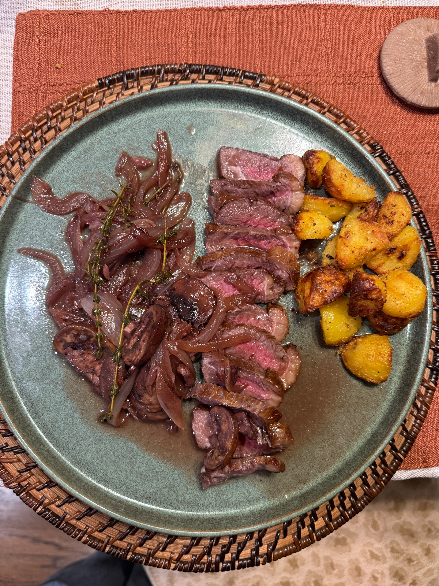

Seared picanha with a red wine, mushroom and onion pan sauce made in the beef fat, plus crispy roasted potatoes. Fall steak night.

## Original
Our own recipe. Crews's idea for a fall steak night: picanha, mushrooms, onion and red wine. See Our version.

## Our version
Serves 2, about 75 minutes, plus salting the steaks ahead. One oven does both jobs: potatoes first at 425°F, then the steaks low and slow at 200°F (reverse sear), then a quick sear in the pan.

**Grocery & inventory check**
- [ ] 2 picanha steaks
- [x] Kosher salt, about ¾ tsp per steak plus more for the potatoes
- [x] Black pepper
- [ ] 1 lb Yukon Gold potatoes, in 1 inch chunks
- [x] 2 tbsp olive oil
- [x] 1 large yellow onion, thinly sliced
- [ ] 8 oz cremini mushrooms, sliced
- [x] 3 cloves garlic, minced
- [ ] 4 sprigs fresh thyme
- [ ] 1 cup dry red wine
- [ ] ½ cup beef stock
- [x] 2 tbsp cold butter, cubed

**Steps**
1. Ahead (4 hours to overnight, or at least 45 minutes): score the fat cap in a crosshatch, cutting through the fat but not into the meat. Salt the steaks (2) all over with kosher salt (about ¾ tsp per steak) and leave them uncovered on a rack in the fridge. Forgot? Salt them right before cooking and leave them on the counter.
2. Heat the oven to 425°F. Toss the potatoes (1 lb, in 1 inch chunks) with the olive oil (2 tbsp), salt and pepper on a sheet pan. Roast 35 to 40 minutes, flipping halfway, until browned and crisp. Already boiled? Pat them dry first and roast 20 to 25 minutes.
3. Take the potatoes out and keep them on the counter. Lower the oven to 200°F and prop the door open a few minutes to cool it down.
4. Set the steaks fat side up on a rack over a sheet pan and put them in the 200°F oven. Start checking with a thermometer at 15 minutes and pull them at 110 to 115°F.
5. Heat a dry stainless pan over medium-high (it has more room for the sauce than the small cast iron). Stand the steaks fat side down (lean them against each other or the pan wall) for 2 to 4 minutes, until the fat is golden and crisp. Turn the heat to high and sear 1 minute per side, until deeply browned and about 120 to 125°F for medium rare. Pour off all but about 2 tbsp of the fat and save it.
6. Move the steaks to a board to rest 10 minutes. Turn the oven back up to 425°F and slide the potatoes back in to rewarm while you make the sauce.
7. Set the pan over medium (the handle is hot). Add the onion (1 large, thinly sliced) with a pinch of salt and cook in the beef fat, stirring now and then, until soft and jammy, 8 to 10 minutes. Add a spoon of the saved fat if the pan looks dry.
8. Push the onion aside, turn the heat to medium-high and add the mushrooms (8 oz, sliced) in one layer. Leave them alone 3 minutes to brown, then stir and cook 3 to 4 minutes more, until browned all over.
9. Add the garlic (3 cloves, minced) and thyme leaves (4 sprigs) and stir 30 seconds. Pour in the wine (1 cup), scrape up the browned bits, and boil until reduced by half, 4 to 5 minutes.
10. Add the stock (½ cup) and simmer 1 to 2 minutes. Take the pan off the heat and swirl in the cold butter (2 tbsp, cubed) a few cubes at a time until glossy. Taste for salt and pepper.
11. Slice the steaks thin against the grain, spoon the sauce over and serve with the potatoes.

If the air fryer is free, cook the potatoes there instead (400°F, 20 to 25 minutes, shaking twice) and set the oven to 200°F for the steaks from the start.

## Notes
- 2026-11-10 (crews via site, 4.5/5): excellent dinner! bit involved but pan sauce turned out delicious
- 2026-11-01 (grok-bot): written from Crews's fall picanha idea (mushrooms, onion, red wine). Amounts are ours for 2 steaks. Planned for the week of 2026-11-02.
- 2026-11-03 (grok-bot): the polenta picanha overcooked after 5 minutes at 275°F, so step 5 now skips the oven for steaks under about 1½ inches and checks temperature much earlier.
- 2026-11-10 (grok-bot): Crews cooked it and found the old step 5 out of order (pull temp came before the oven step) and the oven temps unclear. Rewrote steps 3 to 6 as a reverse sear at 200°F, pull at 110 to 115°F, then a short render and sear in the stainless pan. Added notes for pre-boiled potatoes and for salting late.
