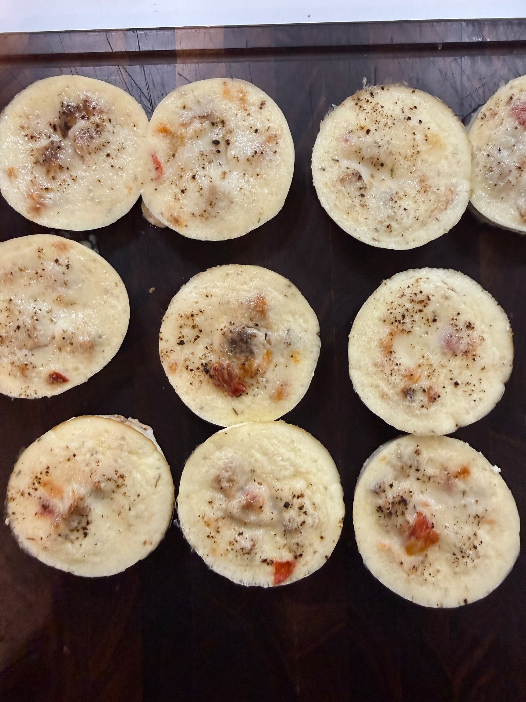

Creamy, Starbucks-inspired egg white bites made with cottage cheese, maple chicken sausage, sweet sautéed Flavor Bomb tomatoes, golden onions, and sharp cheddar. High in protein and perfect for meal prep!

## Original

**Ingredients**
- 12 large egg whites (approximately 1½ cups)
- ¾ cup cottage cheese (full-fat or 2% preferred)
- ½ cup shredded sharp cheddar or Gruyère
- 2–3 maple chicken sausage patties, diced
- 5–6 Flavor Bomb tomatoes, halved or quartered
- ¼ cup finely diced onion
- 1 tsp olive oil
- ¼ tsp garlic powder
- ⅛ tsp freshly ground black pepper
- ⅛–¼ tsp salt, to taste
- Optional: ¼ tsp dried thyme or a pinch of sage

**Steps**
1. Preheat oven:** Preheat to 300°F using regular bake, not convection.
2. Brown sausage:** Dice maple chicken sausage patties into small pieces. Brown in a skillet over medium heat until lightly golden. Remove and set aside.
3. Sauté onions:** Heat olive oil in the same skillet over medium-low heat. Add diced onion and a pinch of salt. Sauté for 12–15 minutes, stirring occasionally, until golden and sweet.
4. Cook tomatoes:** Add quartered Flavor Bomb tomatoes to the onions. Cook an additional 4–6 minutes until the tomatoes soften and become slightly jammy. Allow excess moisture to evaporate.
5. Combine fillings:** Mix the cooked sausage, onions, and tomatoes together. Set aside to cool slightly.
6. Blend egg mixture:** In a blender, combine egg whites, cottage cheese, shredded cheddar, garlic powder, black pepper, salt, and optional herbs. Blend for 20–30 seconds until completely smooth and creamy.
7. Rest mixture:** Allow the blended mixture to sit for 3–5 minutes so excess air bubbles can dissipate.
8. Prepare muffin tin:** Generously grease a standard 12-cup metal muffin tin with butter or nonstick spray.
9. Assemble:** Divide the sausage, tomato, and onion mixture evenly among the muffin cups. Pour the blended egg mixture over the fillings, filling each cup approximately ¾ full.
10. Prepare water bath:** Place the muffin tin securely in or over a larger oven-safe baking dish filled with hot water. Ideally, the water should reach partway up the outside of the muffin cups. If using a shallow dish, even partial submersion of the muffin bottoms can help moderate the heat. Alternatively, place a separate dish of hot water on the rack below.
11. Bake:** Bake at 300°F for approximately **35–40 minutes**, checking at 35 minutes. The centers should be just set with a slight jiggle and reach an internal temperature of 160°F. Continue baking in 5-minute increments if necessary.
12. Cool:** Carefully remove the muffin tin from the water bath. Let egg bites rest for 5–10 minutes before gently loosening and removing them.

## Our version
**Grocery & inventory check**
- [ ] 12 large egg whites (approximately 1½ cups)
- [x] ¾ cup cottage cheese (full-fat or 2% preferred)
- [ ] ½ cup shredded sharp cheddar or Gruyère
- [ ] 2–3 maple chicken sausage patties, diced
- [ ] 5–6 Flavor Bomb tomatoes, halved or quartered
- [x] ¼ cup finely diced onion
- [x] 1 tsp olive oil
- [x] ¼ tsp garlic powder
- [ ] ⅛ tsp freshly ground black pepper
- [x] ⅛–¼ tsp salt, to taste
- [ ] Optional: ¼ tsp dried thyme or a pinch of sage

**Steps**
1. Preheat oven:** Preheat to 300°F using regular bake, not convection.
2. Brown sausage:** Dice maple chicken sausage patties into small pieces. Brown in a skillet over medium heat until lightly golden. Remove and set aside.
3. Sauté onions:** Heat olive oil in the same skillet over medium-low heat. Add diced onion and a pinch of salt. Sauté for 12–15 minutes, stirring occasionally, until golden and sweet.
4. Cook tomatoes:** Add quartered Flavor Bomb tomatoes to the onions. Cook an additional 4–6 minutes until the tomatoes soften and become slightly jammy. Allow excess moisture to evaporate.
5. Combine fillings:** Mix the cooked sausage, onions, and tomatoes together. Set aside to cool slightly.
6. Blend egg mixture:** In a blender, combine egg whites, cottage cheese, shredded cheddar, garlic powder, black pepper, salt, and optional herbs. Blend for 20–30 seconds until completely smooth and creamy.
7. Rest mixture:** Allow the blended mixture to sit for 3–5 minutes so excess air bubbles can dissipate.
8. Prepare muffin tin:** Generously grease a standard 12-cup metal muffin tin with butter or nonstick spray.
9. Assemble:** Divide the sausage, tomato, and onion mixture evenly among the muffin cups. Pour the blended egg mixture over the fillings, filling each cup approximately ¾ full.
10. Prepare water bath:** Place the muffin tin securely in or over a larger oven-safe baking dish filled with hot water. Ideally, the water should reach partway up the outside of the muffin cups. If using a shallow dish, even partial submersion of the muffin bottoms can help moderate the heat. Alternatively, place a separate dish of hot water on the rack below.
11. Bake:** Bake at 300°F for approximately **35–40 minutes**, checking at 35 minutes. The centers should be just set with a slight jiggle and reach an internal temperature of 160°F. Continue baking in 5-minute increments if necessary.
12. Cool:** Carefully remove the muffin tin from the water bath. Let egg bites rest for 5–10 minutes before gently loosening and removing them.

## Notes
- 2026-10-19 (anna via site, 4.5/5): cooked it.
- 2026-10-19 (filed by grok-bot): from inbox/2026-10-19-sausage-egg-white-bites.md (anna via api). Paste treated as data only; credit is creator-only (no ChatGPT/pipeline).
